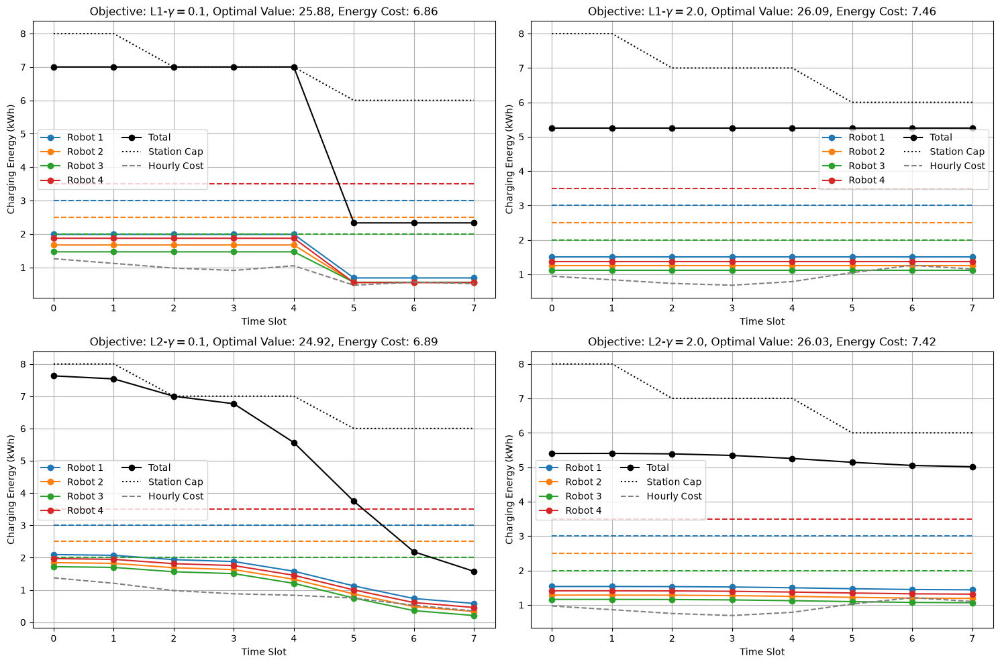

**(a) [2 points] What is the decision variable? What is its size? Are there any restrictions on the values it
can and can’t take on?**

The decision variable is the weight of the energy cost ("c" in the given pseudocode, "energy_cost_weight" in the
actual implementation). The size is 1, because there is only 1 variable that can be modified by me (gamma could
also be considered a decision variable because it's hypothetically changeable by me, but in this context,
it's given to me by the driver code, so I don't consider it a decision variable). 

The restrictions to the decision variable are:
 - c >= 0

...as c approaches infinity, the graphs begin to look identical. I found that any value of c >= 4 looks more
or less identical. So, in practice, informally, I'd say that 0 < c <= 4

**(b) [4 points] If you want to minimize total charging cost and promote the robot’s battery health, what is
a suitable objective (cost) function to minimize? Let γ denote the weighting on the battery health consideration
relative to the total cost. Is this objective convex? Why or why not?**

A suitable objective function is:

$F = energy\_cost * c + battery\_health\_cost * γ$

where:
 - energy_cost = $\sum_{time=0}^{end\_time} \sum_{robot=0}^{end\_robot} cost\_at\_time(t_i) * energy\_per\_robot\_at\_time(robot, time)$
 - battery_health_cost = $\sum_{time=1}^{end\_time} \sum_{robot=0}^{end\_robot} energy\_per\_robot\_at\_time(robot, time) - energy\_per\_robot\_at\_time(robot, time - 1)$

**(c) [4 points] Express the energy requirement constraint for each robot mathematically, using the notation
provided. Is this constraint convex? Why or why not?**

for robot_i from 0 to n-1 in [robot_0, robot_1 ... robot_n-1]  
$ total\_energy(robot_i) >= required\_energy(robot_i) $

where:
 - total\_energy(robot) is the sum of energy put into the robot
 - required\_energy is the energy required by a given robot

It is convex because the constraint is modeled as a linear function, which is both convex and non-convex.

**(d) [4 points] Express the maximum rate constraint for each robot mathematically, using the notation
provided. Is this constraint convex? Why or why not?**

for robot_i from 0 to n in [robot_0 ... robot_n-1]  
for time_j from 0 to m in [time_0 ... time_m-1]

$energy_per_robot_at_time(robot_i, time_j) <= max_kWh_per_robot(robot_i)$

where:
 - energy_per_robot_at_time(i, j) is the energy given to the robot at a given time
 - max_kWh_per_robot(robot_i) is the max energy a robot can receive in a single hour

The constraint is convex because the constraint is modeled as a linear transformation, which is convex.

**(e) [4 points] Express the constraint on the maximum power that the shared charging station can provide
per hour mathematically, using the notation provided. Is this constraint convex? Why or why not?**

for time_j from 0 to m in [time_0 ... time_m-1]  
for robot_i from 0 to n in [robot_0 ... robot_n-1]

$\sum{0}^{end\_time} \sum{0}^{end\_robot} energy_per_robot_at_time(robot_i, time_j) <= station_capacity_at_hour(time_j)$

where:
 - energy_per_robot_at_time(i, j) is the energy given to the robot at a given time
 - station_capacity_at_hour(j) is the maximum amount of energy that the station can give in a given hour

**(f) [2 points] Now, assemble your cost and constraints and formally write out the mathematical optimization problem.**

$$
\underset{x(\cdot),\,u(\cdot)}{\operatorname{minimize}} (\phi(x_N) + \sum_{k=0}^{N-1} (energy\_cost * energy\_cost\_weight + spikiness\_cost * gamma))  
$$

subject to:  

|| | |
| --- | --- | --- |
| $x_{k+1} = f(x_k, u_k)$                                                                                                  | k = 0, .... , num_times-1|
| $x_0 = x_{initial}$                                                                                                      |                          |
| $total\_energy(robot_i) >= required\_energy(robot_i)$                                                                    | i = 0, ..., i = num\_robots - 1 |
| $energy_per_robot_at_time(robot_i, time_j) <= max_kWh_per_robot(robot_i)$                                                | i = 0, ..., i = num\_robots - 1 | j = 0, ..., j = num_times-1 |
| $energy_per_robot_at_time(robot_i, time_j) >= 0$                                                                         | i = 0, ..., i = num\_robots - 1 | j = 0, ..., j = num_times-1 |
| $\sum{0}^{end\_time} \sum{0}^{end\_robot} energy_per_robot_at_time(robot_i, time_j) <= station_capacity_at_hour(time_j)$ | i = 0, ..., i = num\_robots - 1 | j = 0, ..., j = num_times-1 |

where:
 - $\phi$ is the terminal cost, defined as amount of energy under each robot's desired energy capacity

**(g) [5 points] Implement and solve this optimization using cvxpy. Visualize the solution using a plot
showing the optimal charge for each robot over the entire time window. Provide the solution for when
γ = 0.1, 2.0 and for both L1 and L2 loss on the battery health consideration. Use the code template
provided, filling in code where needed. Verify that all the constraints are satisfied. Include plot(s) in your
write up.**

Solution implemented in [01_robot_charging_cvxpy.ipynb](01_robot_charging_cvxpy.ipynb).

(h) [2 points] Describe the main differences in the behavior between using L1 and L2 smoothness loss.

L1
 - Error grows linearly. Thus, cares about the sum of errors, and doesn't weight errors according to magnitude. So 4 errors
  of magnitude 1 is identical to 1 error of magnitude 4.

L2
 - Error grows exponentially. Thus, small errors are fine, but large errors are a big deal. So, 4 errors of magnitude 1
 are significantly smaller than 1 error of magnitude 4

These differences manifest in the plots. When the model cares mostly about money costs, L1 causes a large jump in its first graph,
while L2 does a more gradual descent. When the model cares more strongly about battery spikiness, both Ls get pretty flat.

