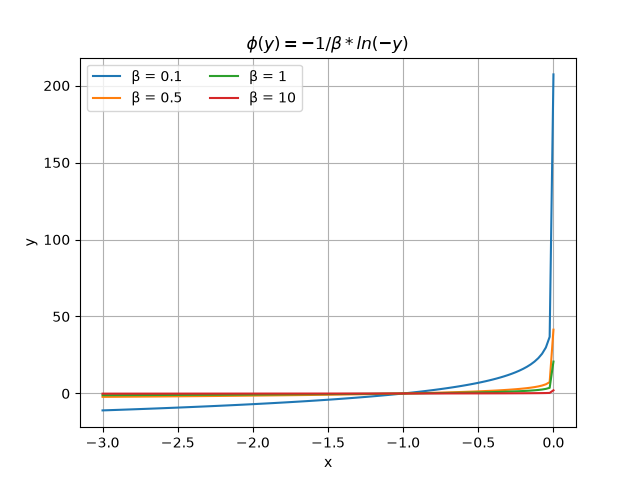
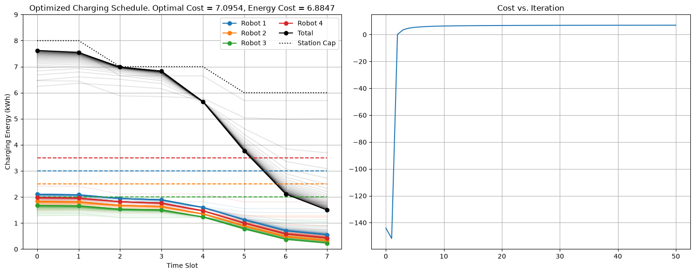

**(a) [4 points] In the provided code template, implement the gradient descent function. It should be general
in that it accepts any differentiable function and gradient descent parameters. In this problem, you will be
using jax. This should not take more than ∼ 4 lines of code.**

Implemented in [02_robot_charging_log.ipynb](02_robot_charging_log.ipynb)

**(b) [4 points] Consider a smooth differentiable scalar-valued constraint g(x) < 0. Consider the function
$ϕ(y) = − 1/β * ln(−y)$ where $β ∈ R>0$. Sketch out the function $ϕ(y)$ for low, medium, and large values of $β$,
all on the same plot. Clearly label the plot. If $y < 0$, how does the gradient of $ϕ(y)$ encourage or discourage
it from moving towards $y > 0$? What happens if $y > 0$? What if the constraint is $g(x) ≤ 0$ instead; does
$ϕ$ provide the capacity to include the $g(x) = 0$ case? Why or why not?**

*Image created with [phi_plotter.py](phi_plotter.py).*

If $y < 0$,the gradient of $ϕ(y)$ discourages it from moving towards $y > 0$ by the extremely steep curve that approaches
infinity between -1.0 and 0.0.

When $y > 0$, the function is undefined, because log of negative numbers is undefined.

If the constraint is $g(x) ≤ 0$, then $\phi$ needs to account for the $g(x) = 0$ case. $\phi$ does not have the
capacity to do this because the log of 0 is undefined.

**(c) [4 points] Using the constraints from the robot charging problem above, write down all the constraints
in the form g(x) ≤ 0. Feel free to utilize indexing notation to avoid tediously listing out every constraint
for i = 1, . . . 4 and t = 1, . . . 8.**

for i = 1, . . . 4 and t = 1, . . . 8

$-charge\_per\_robot\_at\_time(robot_i, time_t) - 1.0 <= 0$  
$required\_kw\_per\_robot[robot_i] - \sum_{j=1}^{8} charge\_per\_robot\_at\_time(robot_j, time_t) - 1.0 <= 0$  
$charge\_per\_robot\_at\_time(robot_i, time_t) - max\_kwh\_per\_robot(robot_i) - 1.0 <= 0$  
$\sum_{j=1}^{4} charge\_per\_robot\_at\_time(robot_j, time_t) - max\_kw\_perR\_hour(time_t) - 1.0 <= 0$  

**(d) [5 points] Given that all the constraints are now transformed into log-barrier functions, the minimization objective (cost) function now becomes**

$$
f(x) − 1/β \sum_{i=1}^{m} ln(−gk(x))
$$

**where f(x) is the original objective function for the constrained problem and gk(x) < 0, k = 1, . . . , m
are all the constraint functions. Thus we have now converted an originally constrained problem into an
unconstrained one.  
&emsp; Use your gradient descent function from (a) to solve this newly unconstrained problem for three different values
for β (low, medium, and high). Use the code provided and include the result plot here. Compare your answer with
the solution with L2 loss for the smoothness penalty and γ = 0.1 with your cvxpy
solution. Do we always recover the cvxpy solution? If not, is it possible to get arbitarily close to it? How
does it relate to your choice of β?**

The answer looks a lot like the cvxpy solution with L2 loss for the smoothness penalty and γ = 0.1. 
We don't always recover the cvxpy solution. Values of $\beta$ end with costs almost ~15% higher
than the cvxpy solution. It isn't until $\beta$ reaches over 100 that the final energy cost comes within
2% of the cvxpy solution. Increasing $\beta$ to 938 brings it to match cvxpy, and a
$\beta$ of 1000 actually gets a lower score than cvxpy. However, I make these statements with only 2 decimal
points of accuracy. With more decimals, it might reveal something else.

