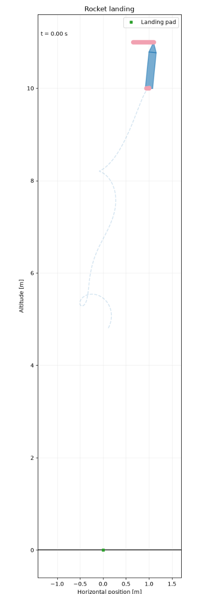
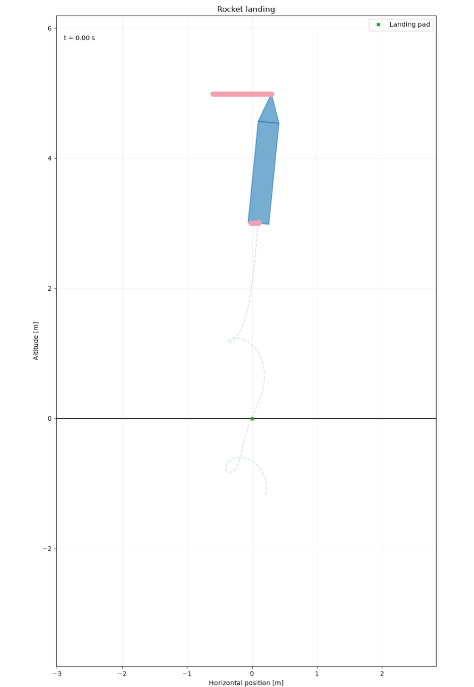

## Problem 2. Rocket landing using sequential quadratic programming

**Learning objective:** Understand how to apply sequential quadratic programming (SQP) to a nonlinear trajectory optimization problem.

In this problem, you will implement sequential quadratic programming (SQP) using cvxpy to plan a landing trajectory for a highly nonlinear rocket system.

Using the notebook `03_rocket_landing.ipynb`, you will build the algorithm progressively: generate an initial trajectory guess, use JAX to linearize the dynamics, formulate and solve the resulting quadratic subproblem with CVXPY, and place these steps inside a loop to perform multiple SQP iterations. You will then extend the formulation to include an obstacle-avoidance constraint. The goal is to understand how a nonlinear trajectory optimization problem can be solved through a sequence of local quadratic approximations, and how the initial guess and constraint formulation affect the resulting trajectory.

**(a)** [4 points] Implement the proportional-derivative (PD) controller described in in the notebook by completing the function `PD_controller`. A PD controller is one that produces a control input that is proportional to both the error and derivative error from a reference value. Don’t forget to enforce the actuator limits specified in the notebook by clipping each thrust command to its allowable range. Experiment with different gain values to observe their impact on controller performance. How challenging is it to tune the gains for a successful, stable landing? Is this tuning process intuitive and practical for any given initial state? Provide a brief explanation, and include plots of your results.  

Implemented in `03_rocket_landing.ipynb`.  
TODO: tune rocket, answer questions

**(b)** [4 points] Complete the function `linearize_dynamics` in the notebook. For the SQP trajectory optimization problem, should you linearize the continuous-time dynamics or the discrete-time dynamics? Explain your choice. Using the model parameters and timestep specified in the notebook, evaluate your function at

```python
state = jnp.array([0.2, 10.0, 0.1, 0.2, -0.1, -0.05])
control = jnp.array([100.0, 200.0, -50.0])
```

and report the numerical values of A, B, and the affine offset vector C to four significant figures, along with their dimensions.  

Completed the function `linearize_dynamics`.  
I should linearize discrete-time dynamics because:
 - Simpler
 - We're evaluating along discrete time steps, so it's a better match. If we linearized along the continuous dynamics, we'd lose the gradient
 values in between steps. Because we're linearizing where we're time-stepping, we get to include all of the gradient values.

numerical values of A, B, and the affine offset vector C:
```
A - (6,6):
[[1.000,     0, -3.909e-4, 0.01000,       0, -1.663e-6],
 [    0, 1.000, -2.832e-4,       0, 0.01000, -4.560e-6],
 [    0,     0,     1.001,       0,       0,   0.01000],
 [    0,     0,  -0.07813,   1.000,       0, -4.834e-4],
 [    0,     0,  -0.05676,       0,   1.000, -1.220e-3],
 [    0,     0,    0.2407,       0,       0,     1.001]]

B - (6,3):
[[ 3.621e-6, -1.620e-7, -1.782e-6],
 [-1.600e-7,  2.016e-6,  3.734e-7],
 [-5.429e-6,  5.428e-7,  1.267e-5],
 [ 7.243e-4, -3.234e-5, -3.566e-4],
 [-3.159e-5,  4.032e-4,  7.371e-5],
 [-1.086e-3,  1.083e-4,  2.534e-3]]

C - (6,)
[3.892e-5, -4.616e-4, -1.199e-4, 7.757e-3, -9.254e-2, -2.392e-2]
```

**(c)** [2 points] Use your `linearize_dynamics` function to linearize the dynamics along a given state and control trajectory, obtaining $A_k$, $B_k$, and $C_k$ for every $k = 0,\ldots,N-1$. Implement this operation in the relevant notebook cell using `jax.vmap`. This should only take one line of code. Provide the single line of JAX code you used in your written response.

```
As, Bs, Cs = jax.vmap(linearize_dynamics, in_axes=(None, 0, 0))(rocket_dt, jnp.array(states[:-1]), jnp.array(controls))
```

**(d)** [10 points] Set up the inner QP subproblem using CVXPY. Much of the setup is provided in the notebook; complete the objective and constraints using the variables and parameters already defined. Test your implementation by linearizing about the trajectory generated by the PD controller, solving the QP once, and visualizing the resulting trajectory by applying the optimized control sequence to the nonlinear dynamics. Include the plot in your written response. Would you expect a single QP solve to produce a good landing trajectory from this initial guess? Explain your reasoning.



So obviously, this isn't an optimal sequence. I'm attributing the sequence to something wrong in my code.  
I wouldn't expect a single QP solve to produce a good trajectory from this initial guess because this is very far off from an optimal solution. Optimization is
naturally iterative, so it's unrealistic to expect good results from a poor initialization. If the initialization was better (maybe if it looked like the PD controller's
sequence), I'd expect decent results pretty quickly, maybe even on the first result.

**(e)** [8 points] Implement the SQP iteration loop using the CVXPY problem from part (d). Starting with the PD controller trajectory as the initial guess, use a for loop to repeatedly linearize the dynamics about the previous solution, update the CVXPY parameters (including the dynamics matrices and reference state and control trajectories), and solve the QP. Run your implementation for multiple SQP iterations and visualize the resulting trajectories, including the nonlinear rollout of the final control sequence. Include the plot in your written response. Experiment with the cost weights $Q$, $R$, $Q_{\mathrm{trp}}$, and $R_{\mathrm{trp}}$. Describe how these choices affect the landing trajectory, control effort, and progress across SQP iterations, and support your discussion with results from your experiments.



Again, this obviously isn't correct.  
TODO: do some experimenting after fixing the code


**(f)** [Ungraded] Add a circular obstacle constraint that prohibits the rocket’s base from entering a specified circular region. Copy your CVXPY formulation from the previous parts to create a new problem with this additional constraint. The obstacle constraint function is provided in the notebook; linearize it about the reference state trajectory and introduce CVXPY parameters for its linear and constant terms. Add the resulting affine inequality at every state timestep, including the terminal state. Following the same approach used for the dynamics, update the obstacle linearization parameters about the previous solution at each SQP iteration. Run your implementation and provide a plot of the rocket’s base trajectory avoiding the obstacle, showing the circular region on the same axes. Is obstacle avoidance feasible for every initial state? Explain your reasoning. What changes could you make to ensure that the optimization problem remains feasible?


