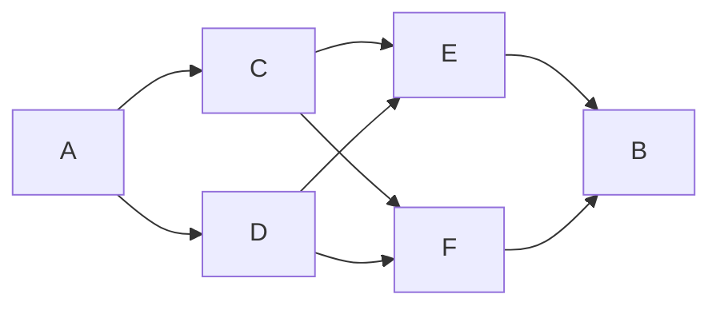

## Problem 1. Warehouse Robot Routing with Dynamic Programming
Learning objective: Apply Bellman’s equation to compute an optimal route, recover an optimal policy,
and explain how battery constraints change the state needed for dynamic programming.

An autonomous warehouse robot must deliver a package from loading dock A to packing station B.
It travels along the directed aisle network below. Each arrow represents an allowed move; travel in the
reverse direction is not allowed. Travel times are deterministic and include delays at busy crossings. The
robot’s objective is to minimize the total time until it first reaches B.

   The table gives the travel time and battery consumption for each move. Battery consumption will be
used only in parts (c)–(g).

| Move | Travel time (minutes) | Battery consumption (units) |
|---|---:|---:|
|A→C|2|2|
|A→D|4|1|
|C→E|2|1|
|C→F|5|1|
|D→E|3|1|
|D→F|2|2|
|E→B|2|3|
|F→B|4|1|

For parts (a)–(b), ignore battery consumption and charging. Let V (v) denote the minimum remaining
travel time from location v to B. No coding is required for this problem. Show your Bellman calculations,
rather than only listing complete routes.

### (a) [5 points]

 Evaluate Bellman’s equation backward through the network: first at E and F , then at C and
D, and finally at A. Report each cost-to-go value and an optimal next move at each nonterminal location.
Explain why this evaluation order allows you to compute the values in one backward pass.

E <- B  :   2       update path: E -> B
F <- B  :   4

D <- E  :   3 + 2   update path: D -> E -> B
C <- E  :   2 + 2   update path: C -> E -> B
D <- F  :   2 + 4   update path: D -> F
C <- F  :   5 + 4

A <- C  :   2 + 4   update path: A -> C -> E -> B
A <- D  :   4 + 6   update path: A -> D

This evaluation allows me to compute the values in one backward pass through the magic of dynamic programming.
Because I keep track of optimal answers as I go, and by leveraging the principle of optimality, I never
have to recompute values.

### (b) [2 points]

 Starting at A, follow your optimal next moves to recover the optimal route and its total
travel time. If you somehow end up on D, would you still know what the optimal path to B is?

Optimal path:
A -> C -> E -> B

If I somehow ended up on D, I'd still know what the optimal path is because the Bellman equation
stores optimal solutions at each explored node, not just nodes along the optimal path.

**Now include the battery. The robot has a capacity of 4 battery units and starts at A with a full battery.
Battery levels are integers b ∈ {0, 1, 2, 3, 4}. A move v → w is allowed only if the current battery level
is at least the consumption $e_{vw}$ listed in the table. The move reduces the battery by exactly $e_{vw}$ units.
Reaching B with zero battery is allowed.
Location E has the only charging station. At E, the robot may take a charge action that takes 3 minutes
and restores its battery to 4 units, regardless of its current level. This action is available only when b < 4;
it does not change the robot’s location. There is no other charging, energy recovery, or waiting action.
The objective now includes both travel and charging time. The task ends immediately upon reaching B.**

### (c) [4 point]

 Explain why location alone is no longer a sufficient state. Define an augmented state and
express the full augmented state space using set notation. Include all combinations of graph locations and
allowed battery levels, even those that cannot be reached from the specified initial condition (A, 4) along
the directed network. In particular, distinguish membership in the state space from reachability from the
initial condition; a state can belong to the state space even if it is never visited in this particular delivery
task.  

Location alone is no longer a sufficient state because the battery is a critical constraint that affects the
robots ability to get to a location.  

Augmented state vector:
$z=\begin{bmatrix}x_0^\top & \cdots & x_N^\top & b_0^\top & \cdots & b_{N-1}^\top\end{bmatrix}$
 - x : location along path
 - b : battery state
 - N : # time steps (N implies a clearly bounded time space, but it's not)

b ∈ {0, 1, 2, 3, 4}  
x ∈ {A, B, C, D, E, F}  
b_{init} = 4  
x_{init} = A  

TODO: is this what the question is asking?

### (d) [12 points]

 Fill out the table below to describe the robot’s actions using the augmented state from
part (c). You are encouraged to use symbolic notation to give one row for a general travel action, one
for charging at E, and one for the terminal states at B, rather than enumerating every battery level and
every state. But you can enumerate all states and actions if you prefer (more rows will be needed). In the
allowable-actions column, include the conditions under which each action is allowed. Give the immediate
time cost in minutes; for terminal states, indicate that there is no further action or next state and no
additional cost.

TODO: am I describing a policy that the robot could abide by, or the states it goes thru?

| State     | Allowable actions | Next state    | Cost |
|---        |---                |---            |---|
| Travel    |                   |            |      |
| Charging  | x == E            |            |      |
| Done      |                   |            |      |

TODO: is this what the question was asking for?
| State     | Allowable actions                  | Next state    | Cost |
|---        |---                                 |---            |---|
| A         | (x=C,t=2,b=2), (x=D,t=4,b=2)       | x=C,t=2,b=2   | t=2,b=2     |
| C         | (x=E,t=4,b=1), (x=F,t=7,b=1)       | (x=E,t=4,b=1)   | t=2,b=1     |
| E         | (x=E,t=7=2,b=4)                    | (x=E,t=6=2,b=4) | t=3     |
| E         | (x=B,t=9,b=1)                      | (x=B,t=9=2,b=1) | t=2,b=3     |
| B         |                                    |                  |      |

### (e) [5 points]

 Let J(v, b) be the minimum total time needed to reach B from location v with battery level
b, including any charging time. Specify J(B, b) for all battery levels. If no allowable sequence of actions
can reach B, set J(v, b) = +∞. Write the Bellman expressions for J(E, 4) and J(E, 1). Which value
should you compute first, and why?

TODO: feels like this is not a real question? 
| location v | battery-level b | minimum total time needed to reach B |
| B          | 0               | 0                                    |
| B          | 1               | 0                                    |
| B          | 2               | 0                                    |
| B          | 3               | 0                                    |
| B          | 4               | 0                                    |

J(E, 4) should be computed first because the Bellman equation works by starting at the most optimal point
and working backwards. 4 battery is better than 1 battery, so it should be computed first. After a path
is calculated, we can see that to get to B from (E, 1), we must first pass through (E, 4). 

J(E, 4) = 2  
J(E, 1) = 5  

### (f) [10 points]

 Perform a full backward dynamic programming sweep using Bellman’s equation to compute
J(v, b) for every location and battery level in the augmented state space, including states that are not
reachable from (A, 4). Present your cost-to-go values in a table, with locations as rows and battery levels
as columns. Record an optimal action for each nonterminal state from which B can be reached, and mark
states from which B cannot be reached with +∞. Show your Bellman calculations and include both travel
and charging time.
Use your resulting policy to recover the optimal plan from (A, 4). List each action and the resulting
location and battery level, including any charging, and report the minimum total time to reach B.

| node_name | 0 | 1 | 2 | 3 | 4 |
|:----------|--:|--:|--:|--:|--:|
| A | +∞ | 9 | 6 | 6 | 6 |
| B | 0 | 0 | 0 | 0 | 0 |
| C | +∞ | 4 | 4 | 4 | 4 |
| D | +∞ | 5 | 5 | 5 | 5 |
| E | 5 | +∞ | +∞ | 2 | 2 |
| F | +∞ | 4 | 4 | 4 | 4 |

### (g) [Ungraded]

 Suppose the charging time is changed from 3 minutes to a parameter τ > 0, with all other
data unchanged. Determine the charging time at which a plan that uses the charger and a plan that avoids
it have equal minimum total time from (A, 4). Identify an optimal plan on each side of this threshold.
Justify your answer using the candidate action costs in Bellman’s equation.
